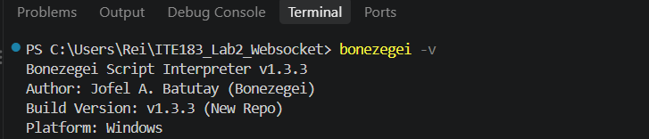
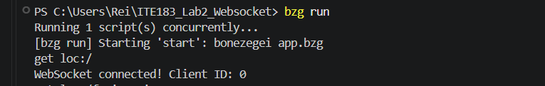
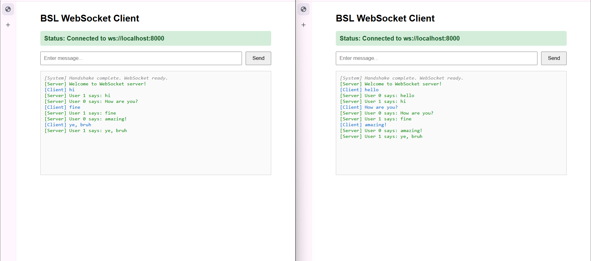
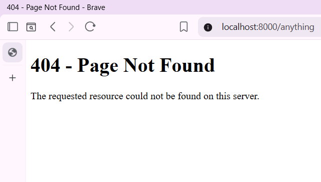

# ITE183 Lab 2: WebSocket Server

A real-time WebSocket chat server built using Bonezegei Scripting Language v1.3.3.

The server serves a static HTML chat client, handles WebSocket connections, identifies connected clients, tracks disconnections, and broadcasts chat messages to all active clients.

## Features

- HTTP server on port `8000`
- Static file serving from the `public/` directory
- Custom 404 page for undefined routes
- WebSocket connection handling
- Unique client identification
- Real-time message broadcasting
- Multi-client chat support
- Connection and disconnection tracking

## Requirements

- Bonezegei Scripting Language v1.3.3
- BSL package manager (`bzg`)
- A modern web browser

## Installation

Verify the BSL version:

```powershell
bonezegei -v
```

Expected output:

```text
Bonezegei Script Interpreter v1.3.3
```

Install the required packages:

```powershell
bzg install
```

## Running the Server

Start the WebSocket server:

```powershell
bzg run
```

The server runs on:

```text
http://localhost:8000/
```

## Testing the Chat

Open the following URL in two or more browser windows:

```text
http://localhost:8000/
```

Send a message in one browser window. The message should appear in every connected browser window as:

```text
User <clientId> says: <message>
```

To test the 404 page, open:

```text
http://localhost:8000/anything
```

## Project Structure

```text
ITE183_Lab2_Websocket/
├── .gitattributes
├── LICENSE
├── README.md
├── package.json
├── app.bzg
├── documentation/
│   ├── version.png
│   ├── server.png
│   ├── chat.png
│   └── 404.png
└── public/
    ├── index.html
    └── 404.html
```

## Screenshots

### BSL version verification



### Server installation and startup



### Multi-client chat broadcast



### Custom 404 page



## License

This project is licensed under the MIT License.